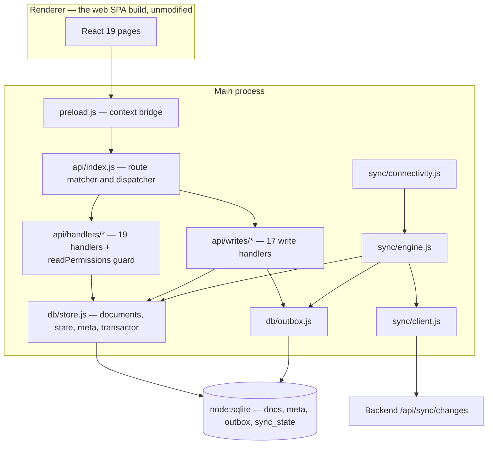

# 08 — Desktop Application

*Documented commit `fc8cf6d`. Source: `OfflineSchoolApp/desktop/`.*

Electron. It does **not** contain its own UI: it builds the web app
(`npm --prefix ../web run build`) and serves that bundle, then intercepts the
SPA's own API calls in the main process and answers them from a local document
store. To the renderer it looks like the server is simply there.

---

## Architecture



Entry point is `src/main/main.js` (`package.json` `main`). There are **57 source
files** in `src/main/`.

---

## The local store — IMPLEMENTATION VERIFIED

`src/main/db/store.js`, built on **`node:sqlite`** (`DatabaseSync`) — Node's
built-in SQLite, not `better-sqlite3`.

### Four tables

| Table | Purpose |
|---|---|
| `docs` | The document mirror. `(collection, id)` plus columns lifted out of the JSON because sync and every query filter on them; `base_json`/`base_state` keep the server's version under a pending row (migration 5). |
| `sync_state` | Per-collection cursor. |
| `outbox` | Queued writes. |
| `meta` | Schema version and bookkeeping. |

### The API surface

```js
const { open, migrate, documents, state, meta, transactor, SCHEMA_VERSION }
  = require("./db/store");
```

- `documents(db)` — document reads and writes, and **its own** `tx` helper.
- `state(db)` — `cursorFor(collection)`, `setCursor(collection, cursor)`.
- `meta(db)`, `transactor(db)`.

> **Trap for future work:** `transactor(db)` and `documents(db).tx` each maintain
> their **own** transaction-depth counter. Nesting one inside the other raises
> *"cannot start a transaction within a transaction"*. Production code correctly
> uses `docs.tx`; a test harness that reaches for `transactor` around it will
> fail in a way that looks like a store bug and is not.

---

## Migrations and version safety — IMPLEMENTATION VERIFIED

`src/main/db/schema.js` holds an ordered `MIGRATIONS` array;
`SCHEMA_VERSION` is the last entry's version (`schema.js:267`). **Currently 5.**

| Version | Name |
|---|---|
| 1 | documents, sync cursors and the outbox |
| 2 | separate replay identity from double-submit identity |
| 3 | one request may have changed more than one row |
| 4 | the outbox remembers who queued each request (`outbox.user_id`) |
| 5 | a pending row remembers the server's version under it (`docs.base_json`, `base_state`) |

Each migration runs **inside a transaction together with its version bump**, so a
half-applied migration cannot exist. A school's data is not somewhere to discover
that a schema change stopped halfway.

### Refusing a newer database

```js
if (current > SCHEMA_VERSION) {
  // refuse to open — "Update the application rather than downgrading it."
}
```

If the on-disk database was written by a **newer** build than the running binary,
the store refuses to open it. Silently operating against a schema you do not
understand corrupts data; refusing is recoverable. On a refusal — or a migration
failure — the handle is closed, so `migrate` can be retried without ending the
process.

### Migration 2 — worth reading before touching the outbox

`idem_key` was doing two incompatible jobs. It was set to the document id, and
being `UNIQUE` it also served as the guard against a form submitted twice.

Both jobs were done wrongly by one value: a queued **edit** to a document that
already had a queued **create** hit the unique constraint, was reported as a
duplicate and was **discarded** — somebody's change disappeared while the UI
showed it applied. And had it reached the server, the idempotency middleware
scopes stored responses by `(key, userId)` *without the path*, so the edit would
have been answered with the create's response.

The split:

| Column | Identifies | Unique? |
|---|---|---|
| `idem_key` | an **operation** — one queued request | `UNIQUE` |
| `dedupe_key` | an **intent** — e.g. a double-clicked create | indexed, **not** unique |

`dedupe_key` is checked only against entries *still queued*, so repeating the same
intent later is legitimate — a person doing the same thing twice on purpose.

### Migration 5 — discard restores the server's version

Discarding a refused **edit** used to delete the row: the record vanished and the
pull never brought it back (the cursor was already past it). Now, when a row goes
pending, the version it replaced is kept (`base_state` 0 = local create, 1 =
`base_json` is the last server-confirmed version, NULL = pending before the
migration). A discard puts `base_json` back, or removes a create. A write the
server accepts while a later one for the same row is still queued updates
`base_json` to the server's answer (`store.js:417`).

A row stays **pending until its last queued write settles** — any pending or
blocked entry that wrote it keeps it protected from the pull (`outbox.js:269`).

---

## The outbox

```text
outbox(
  seq          INTEGER PRIMARY KEY,   -- ordering
  idem_key     TEXT NOT NULL UNIQUE,
  dedupe_key   TEXT,                  -- migration 2
  user_id      TEXT,                  -- migration 4: who queued it
  attempts     INTEGER NOT NULL DEFAULT 0,
  next_try_at  TEXT,
  last_status  INTEGER,
  last_error   TEXT,
  status       TEXT NOT NULL DEFAULT 'pending'
)
CREATE INDEX idx_outbox_status ON outbox(status, seq);
```

### Ordering

`seq` is a monotonic integer and the drain loop reads in `seq` order. Where mobile
coalesces by `entity_key`, desktop preserves strict submission order.

### Retry policy — IMPLEMENTATION VERIFIED

```js
BACKOFF_SECONDS = [5, 15, 60, 300, 600];
```

`isRetryable(status, code)`:

| Condition | Retryable |
|---|---|
| no status at all (network/DNS) | **yes** — the ordinary offline case |
| `408`, `429` | yes |
| `409` **with** `IDEMPOTENCY_IN_PROGRESS` | yes |
| any `5xx` | yes |
| anything else | **no** → `status = 'blocked'`, `next_try_at = NULL` |

A `blocked` row **stops the queue**: the drain loop breaks on it rather than
skipping past. Later writes may depend on it, so continuing would apply them
against a state that never happened.

> A replay landing on something already stored must **not** reach here as a 409:
> the endpoints that accept client-generated ids answer `200` with `replay: true`.

`Idempotency-Key` is sent with each request so a replay is answered with the
original response rather than creating a second record.

### Ownership

Each entry records the account that queued it. Discard / Try again / Save a copy
are offered only to that signed-in account (`ownOutboxActions`, `outbox.js:432`);
another account on the same machine sees the entry but cannot act on it. Entries
queued by an account whose session has expired are shown as "sign in again to
send N" (`main.js:333`).

### Reconnecting — `sync/connectivity.js`

While online nothing runs. After a cycle fails to reach the server (or the OS /
window reports offline), a cheap local `net.isOnline()` check runs every few
seconds; when it flips, the server's `/api/health` is probed, and only its answer
counts. On reconnect a cycle runs **immediately** with **network-failure
backoffs brought forward**; backoffs the server asked for (`5xx`, `429`, `408`)
are kept, and blocked entries stay blocked (`outbox.js:249`). Offline, the engine
retries a cycle every 15 s (`engine.js:40`).

---

## Sync — `/api/sync/changes`

Desktop uses the **feed**, not the mobile pull. 42 collections (incl.
`syncTombstone`; `FEED` in `backend/src/config/syncFeed.js`), capability-gated,
keyset cursor per collection. Protocol detail is in
[10-synchronization.md](10-synchronization.md); what is desktop-specific:

### Each page and its cursor commit together

```js
// The page and its cursor commit in a single transaction. Written the other way
// round, a crash between them loses the page and keeps the cursor.
```

### The cursor stops at the last document actually written

If a document in the page could not be stored, the cursor does **not** move past
it. Otherwise the row is skipped forever with nothing to notice it. The engine
either keeps the previous cursor or synthesises one at the last successfully
written document.

### Refused collections are dropped, not retried

The server answers with the collections this caller's capabilities permit. Any it
refuses are removed from the request list for the rest of the cycle rather than
being asked for again on every page. **TEST VERIFIED** by
`scripts/check-sync-engine.js` — *"a refused collection is reported and then left
alone"*.

### Tombstones are applied generically

`syncTombstone` rows remove the named row (`store.applyTombstones`, called from
`engine.js:334`) for every tombstoned entity — subjects, assignments, pupils,
users, result summaries / term / annual results, enrolments, promotion runs and
decisions (`SyncTombstone.ENTITIES`). A non-admin also receives **"unpublished"**
tombstones, since its mirror holds only published results. A row with a local
write still queued is **held**, and the cursor stops there.

### Stale-sync warning

The engine records the last cycle that reached the server; the window warns
from day **21** and the offline period ends at **30** days
(`engine.js:125`, `web/src/config/offlinePeriod.ts`).

### One cycle at a time

An in-flight cycle is not a refusal; a second trigger is ignored rather than
starting a concurrent pass over the same cursors.

---

## What is answered offline

`node scripts/coverage.js` (a floor, not a census) at this commit: **285**
endpoints called by the console — **142 answered offline (50%)**, 58
deliberately online-only (20%), 85 still to do (30%). Notable offline paths:

- **Local read permission guards** — `api/handlers/readPermissions.js` wraps a
  handler with the server route's permission/role check; without it the read is
  not answered locally (online the server says 403). Nothing is removed from disk.
- **Messages** — `handlers/messages.js`: conversations and threads from this
  account's cache; sending queues, except to a read-only/archived conversation.
- **Provisional receipts** — `handlers/receipts.js`: a payment whose create is
  still queued prints the shared receipt template marked PROVISIONAL; once
  confirmed, the receipt is the server's.
- **Class, subject and assignment creates** offline under client ids
  (`writes/structure.js`, `classes.js`, `subjects.js`, `assignments.js`). A body
  with no id stays online. **Bulk** assignment create stays online-only — the
  backend ignores client ids there (`writes/assignments.js:24`).

## Packaging

| Script | Command |
|---|---|
| `npm start` | `node scripts/launch.js` |
| `npm run build:web` | `npm --prefix ../web run build` |
| `npm run package` | `build:web` then `electron-builder --config electron-builder.yml` |
| `npm run package:dir` | as above with `--dir` (unpacked, for testing) |

`desktop/dist/` holds build output. Because the renderer is the web build,
**a desktop release requires a working `web` build** — the two packages are
coupled at package time even though they are independent npm projects.

`scripts/check-request-path.js` asserts that every `shared/` module the desktop
imports still resolves *once the application is installed*, which relative paths
from a packaged asar do not do for free.

---

## Verification — TEST VERIFIED

```bash
cd OfflineSchoolApp/desktop
npm run check
```

**24 suites** chained in `package.json` `"check"` — protocol, tombstones,
mirror-tombstones, unsent, routes, store, outbox, crash, sync, path,
student-writes, score-writes, process-rules, results, settings, roster,
reliability, initial-sync, messages, receipt, read-perms, outbox-owner, recovery,
structure-creates. (`check:launch` and `check:seam` exist but are not in the
chain.) Not re-run for this revision.

CI runs this job with `ELECTRON_SKIP_BINARY_DOWNLOAD=1` — nothing in
`npm run check` touches Electron itself, so skipping the ~100 MB binary removes
the flakiest step in the install.

---

## Desktop versus mobile

| | Mobile | Desktop |
|---|---|---|
| Storage | `expo-sqlite`, ~40 relational tables | `node:sqlite`, 4 tables, documents as JSON |
| Sync endpoint | `GET /api/sync/changes?profile=phone` (older builds: `/sync/pull`) | `GET /api/sync/changes` |
| Collections | 6 + tombstones (`PHONE_FEED`) | 42 |
| Cursor | `(updatedAt, _id)` per collection (older builds: one timestamp) | `(updatedAt, _id)` keyset, per collection |
| Outbox ordering | `created_at`, coalesced by `entity_key` | strict `seq` |
| Replay identity | `Idempotency-Key` + derived `_id` | `idem_key` (operation) + `dedupe_key` (intent) |
| Blocked write | `failed` after 8 retries; queue continues | `blocked`; queue **stops** |
| Schema versioning | per-table `PRAGMA` probes, no global version | global `SCHEMA_VERSION`, refuses a newer DB |

Neither is deprecated, and there is no scheduled convergence.
