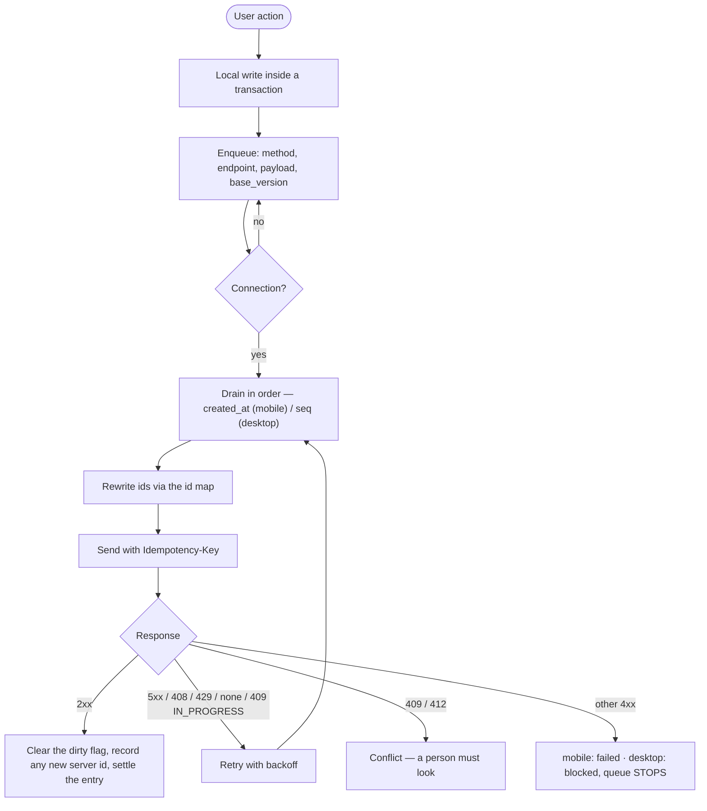

# 10 — Synchronization

*Documented commit `be2d2ac`.*

**There are two independent sync protocols.** They do not share code, cursors,
storage or design. Both are live and supported. Confusing them is the most likely
source of a wrong change in this system, so this document treats them separately
throughout.

| | Mobile (since 2026-11) | Mobile (older builds) | Desktop |
|---|---|---|---|
| Pull endpoint | `GET /api/sync/changes?profile=phone` | `GET /api/sync/pull` | `GET /api/sync/changes` |
| Controller | `syncFeed.controller.js` + `config/syncFeed.js` `PHONE_FEED` | `sync.controller.js` | `syncFeed.controller.js` + `FEED` |
| Collections | **6** + hard deletes | **6** | **36** |
| Cursor | `(updatedAt, _id)` per collection, per account | one timestamp | `(updatedAt, _id)` per collection |
| Pagination | `limit` 500, max 2 000 | per collection, cut at 2 000 (`hasMore`) | `limit`, default 500, max 2 000 |
| Audience | `/sync/pull`'s, per role (below) | per role (student narrowed) | per collection, per permission |
| Push | ordinary REST endpoints via the outbox | same | same |

> **2026-11 — read this first.** Both feeds hand out **commit-safe** cursors
> (see *Commit-safe cursors*), `/sync/pull` answers in **bounded pages**, and the
> phone reads its six collections from `/sync/changes` with a **phone profile**.
> The sections below that describe `/sync/pull` describe what older phone builds
> still use; it is kept, not removed.

`POST /api/sync/push` is retired: it answers **410 `SYNC_PUSH_RETIRED`** to any authenticated caller and writes nothing. The `sync.push` permission was removed with it (`RETIRED_KEYS` in `config/permissions.js`); a stored override still naming it is dropped on read and on save (`scripts/check-retired-permissions.js`). See [06](06-authentication-authorization.md).

---

## Mobile — `GET /api/sync/pull`

### Request

```http
GET /api/sync/pull?lastSync=2026-09-01T12:00:00.000Z
Authorization: Bearer <JWT>
```

### Response — IMPLEMENTATION VERIFIED

```json
{
  "success": true,
  "data": {
    "classes":      [],
    "teachers":     [],
    "subjects":     [],
    "periods":      [],
    "assignments":  [],
    "students":     [],
    "deletedItems": []
  },
  "timestamp": "2026-09-01T12:05:00.000Z"
}
```

Six collections. `teachers` is `User` filtered to `role: "teacher"`. A
student's token receives only their own `students` row, and teacher names
without email or account state — in `teachers` and in the teacher joined to
each assignment.

### Deletions — how a removal reaches a phone (2026-10-17)

The contract is **in-row tombstones**, the same as the desktop feed: a row
that arrives with `deletedAt` set is marked deleted on the phone (each
`sync*` apply function in `mobile/src/services/syncManager.js`), and a row
that arrives without it is upserted and un-deleted.

| Pull | What is sent |
|---|---|
| **First** (no `lastSync`) | live records only, as before: `deletedAt: null`; students `status: "approved", isActive: true`. `deletedItems: []`. |
| **Incremental** (`lastSync` sent) | every row changed since the cursor, **including** soft-deleted ones (classes, periods, teachers); students who left the roster (no longer approved and active) as `{ _id, schoolId, deletedAt }`; and **hard deletes** from their tombstones, in the same shape. `deletedItems` lists every removal as `{ collection, id, deletedAt }` (informational). |

**Hard deletes** (subjects, teacher assignments, students — including the
subjects and assignments a class delete cascades to) leave no row, so the
`syncTombstones` plugin (`src/db/plugins/syncTombstones.js`) writes a
`SyncTombstone` (`schoolId, entity, docId, deletedAt`) **before** each delete,
on the model, for every delete path. A tombstone whose row still exists (a
delete that failed after writing it) is never sent. Tombstones are **never
discarded**: a device offline for a term still receives every removal.

**Stale uploads:** creating a subject, assignment or student under the `_id` of
a tombstone is refused `410 RECORD_DELETED` — several create routes accept the
client's `_id`, and a queued create would otherwise bring the record back. The
phone's outbox treats a 410 on a create as permanent (parked as failed, shown);
the desktop blocks its queue on it until a person discards the change.

**Cursor:** unchanged — the inclusive `since` and the timestamp taken before
the queries. A removal stamped exactly on the cursor is sent twice rather than
never; applying it twice is a no-op. `check:syncdeletions` pins all of this.

The 410 guard also covers the bulk paths that skip save middleware —
`Model.insertMany`, and `Model.bulkWrite` insertOne and upserts on `_id` — and
`bulkWrite` deleteOne/deleteMany write tombstones. A batch holding a deleted id
is refused whole, naming the ids (`err.deletedIds`); nothing is silently
dropped. Only raw driver writes (`Model.collection.*`) bypass both.

### Desktop: hard deletes reach the mirror (2026-10-17)

`/sync/changes` carries a `syncTombstone` collection: one row per hard-deleted
subject, teacher assignment or pupil, paged on `(updatedAt, _id)` like every
collection. Scoped to what the caller may mirror — subject and assignment
tombstones with `subjects.view`; pupils with `students.view`, or for a teacher
with only `students.viewTaught` the pupils of the classes they teach (the
tombstone keeps `classId`); refused by name to anyone else. A tombstone whose
row still exists is not sent (`postFilter`), and the cursor still passes it.

The desktop engine **removes** the named row (`store.applyTombstones`) — the
server no longer has it, and some endpoints the mirror answers for apply no
deleted filter — never creates one, and **holds** a row with a local write
still waiting (as `merge()` does): the cursor stops there until that write is
resolved, so nothing typed is lost.

Also fixed on the way: the feed controller assigned the cursor's `$or` over a
scope's own `$or`, which would have sent every row past the cursor regardless
of scope. No scope used `$or` before; now the two are combined under `$and`.
`check:feedtombstones` (backend) and `check:tombstones` (desktop) pin it.

### Stale queued creates that fail with 410

Phone: the outbox classifies a 410 on a create as permanent and parks it as
failed, shown to the user. Desktop: a 410 blocks the queue at that entry; the
sync indicator shows the server's message and, for a 410, says the record was
deleted on the server. **Try again** is not offered (it cannot succeed);
**Save a copy** writes the queued request — method, path, the body as typed,
when it was queued, the server's refusal — to a JSON file the person chooses
(`desktop/src/main/unsentCopy.js`); **Discard** (confirmed) then removes the
entry and its local row. Nothing is discarded without the person choosing to.
`check:unsent` (desktop) pins it.

### The cursor, and the one-millisecond hole that was closed

`timestamp` is stamped **before** the queries run, so a row written while they are
in flight is re-sent next time rather than skipped. That reasoning is correct and
it still had a hole, because the filter used to be exclusive:

> Take a cursor stamped at `T`. The queries begin in that same millisecond. A row
> written at exactly `T`, after its collection's query has already run, is not in
> the reply — and the next pull asks for `updatedAt > T`, which excludes it. That
> row is never offered to that device again. Not a delay: a permanent hole, one
> millisecond wide, in whichever collection somebody happened to be writing to.

The filter is therefore **`$gte`**, not `$gt`. The cost is that rows stamped
exactly on the cursor come back once more, which the client already tolerates —
every pull applies as an upsert. **Re-sending is the safe direction; skipping is
not.**

A `lastSync` in the **future** is clamped to the epoch with a warning, so a
device with a bad clock re-syncs everything rather than silently receiving
nothing.

**TEST VERIFIED** by `backend/scripts/check-sync-cursor.js`.

---

## Desktop — `GET /api/sync/changes`

### Request

```http
GET /api/sync/changes?collections=student,feeCharge&cursors=<json>&limit=500
Authorization: Bearer <JWT>
```

| Parameter | Default | Max |
|---|---|---|
| `limit` | 500 | 2 000 |
| `collections` | all the caller may see | — |
| `cursors` | per collection, from the previous page | — |

### The cursor is a pair, and this is the whole point

The obvious design is *"give me everything with `updatedAt > T`"*. It is broken,
and it breaks in a way testing rarely catches: **`updatedAt` is not unique.**

Two documents written in the same millisecond, split across a page boundary, mean
the second is never returned — `updatedAt > T` excludes it along with the first.

So the cursor is the pair `(updatedAt, _id)` and the filter is:

```text
updatedAt > t  OR  (updatedAt = t AND _id > id)
```

with a matching sort. `_id` is unique, so the pair is a **total order** and every
document is offered exactly once. Being a total order, it can be exclusive with no
boundary tolerance at all — which is why the desktop feed does not need the
mobile feed's `$gte`.

The cursor is encoded as `{ at: ISO string, id: string }`. `parseCursor` requires
**both halves or neither** — a cursor carrying only a timestamp is the broken
design, and accepting one would silently reintroduce it.

### Commit-safe cursors (2026-11) — both feeds

`updatedAt` is stamped by the application clock when a document is **built**,
not when the write **commits**. A slow write (a transaction, a bulk insert of a
class's charges) becomes visible with an `updatedAt` behind a cursor already
handed out, sorts before it, and was never offered to that client again — on
both feeds. And a **future-dated** row (an import that kept its timestamps, a
wrong clock) carried the desktop cursor past every row written after it.

The rule, `src/config/syncWindow.js` (window **2 minutes**,
`SYNC_SAFETY_WINDOW_MS`, never below 1 s):

- **`/sync/changes`** — within one *pass* (pages while `hasMore`) the cursor is
  the page's last row, as before: progress is guaranteed and nothing in the pass
  is sent twice. Each cursor also carries `s`, the pass's *floor* — the earliest
  `now − window` any of its pages saw. The cursor a pass **ends** on
  (`hasMore: false`, the one a client keeps) may not rest later than the floor:
  if the last row is later, the server hands back a **resume point**
  `{ at: floor, r: 1 }` (inclusive), and the next pass re-reads from there.
  A write that took less than the window to commit is therefore always
  delivered. (Proof sketch: if it landed after the page that passed its
  position was read, its `updatedAt` is later than that page's clock minus the
  window, which is at or after the floor.)
- **`/sync/pull`** — `timestamp` is `pulledAt − window` (or earlier, see paging).

The cost is the **overlap**: rows changed in the last couple of minutes come
again next pass, which every client applies as the upsert it already is (same
id, same `updatedAt`). A future-dated row is delivered and **re-sent every pass
until real time passes it** — never hidden, and it can no longer blind the
feed, because no resting cursor is later than the server clock minus the
window. Such rows are reported: `futureDated` per collection on `/sync/changes`,
top-level on `/sync/pull`, and a server warning.

Choice: a lagging cursor plus re-read, rather than a server-side sequence
stamped at commit. A commit-ordered sequence needs the oplog / change streams
(a replica set) or a counter round-trip inside every write path; the window
needs neither, works on a standalone server and in-memory tests, and the
desktop needs no change. **Desktop compatibility:** the cursor is opaque to it
— it stores it, sends it back and pages while `hasMore`; a pair it rebuilds
itself (a row held back by a pending local write) is still a valid position
(without a floor, which only makes that one pass's floor "now − window").
`check:commitgap` pins the slow commit, the mid-pass late write, the future
row, and both cursor shapes; `check:desktop` (parity) passes unchanged.

### `/sync/pull` pages (2026-11)

Each collection (and the tombstones) is read in `(updatedAt, _id)` order and
cut at `limit` (default and ceiling **2 000**). When any is cut, `timestamp` is
pulled back to the `updatedAt` of the last row sent from a cut collection and
`hasMore: true` is set. An old build that only stores `timestamp` gets the rest
over its next syncs — nothing skipped. Known edge: more than `limit` rows of one
collection sharing **one millisecond** cannot be split by a plain timestamp, so
an old build would be offered the same first `limit` of them each time (logged).
`check:syncpaging` pins it.

### The phone profile — `GET /sync/changes?profile=phone` (2026-11)

Collections `classes, subjects, teachers, periods, assignments, students,
tombstones` (`config/syncFeed.js` `PHONE_FEED`), with this endpoint's cursor,
pages and commit-safe positions, and **`/sync/pull`'s audience and row shapes**:

| Role | Receives |
|---|---|
| school_admin, bursar, teacher (super_admin with `schoolId`) | the six collections as `/sync/pull` sent them; `students` needs `students.view` or `students.viewTaught` (else refused by name) |
| student | own pupil row only; teacher **names** only (no email, account state or staff number — also in each assignment's joined teacher); only their own pupil tombstone |

Rows: pupils normalised as `/sync/pull` normalises them (off the roster → a
removal row); assignments with teacher/class/subject names joined; tombstones as
`{ collection: "subjects"|"assignments"|"students", _id, deletedAt }`. Teachers
receive the **whole roster**, exactly as `/sync/pull` gave them — narrowing a
teacher phone to taught classes would drop a form-master's class that has no
subject assignment, which is a role-matrix decision. The desktop never sends
`profile`, and its default list (`FEED`) and `KNOWN_GAPS` are unchanged.
`check:phonefeed` compares every role row-for-row with `/sync/pull`.

**The phone** (`mobile/src/services/syncFeed.client.js`, called by
`SyncManager._pullFeed`): pages to the end; applies each page **before** storing
its cursor; re-asks only collections that said `hasMore`; applies through the
same `syncClasses … syncStudents` functions, so the **pull-protection rule** (a
pulled row never overwrites one with `_synced != 1`) holds for classes, teachers,
subjects, periods (`dirty`) and now also teacher assignments (by id or by the
teacher/class/subject key). **Pupils are not under the rule yet**:
`students._synced` is added by the admissions code with `DEFAULT 0` and the pull
never sets it, so it cannot tell a pulled pupil from a changed one — making the
flag trustworthy comes first. A server without the profile (every collection
refused `UNKNOWN_COLLECTION`) → the phone falls back to `/sync/pull`. Students'
phones still do not pull the six (unchanged). Everything else the phone mirrors
(fees, attendance, exams, finance, timetable, gate, homework, messages,
announcements, quizzes) stays on its REST lists: those tables have their own
shapes and per-role routes, and the feed's capability-scoped entries
(`feeCharge`, `studentAttendance` …) would need per-table apply code and,
for teachers, scopes the feed does not yet express.

`check-sync-feed-phone.js` (mobile, real backend) pins the move.

### Sync position per account (2026-11)

The phone's cursors (`sync_last_timestamp`, `quiz_last_sync`,
`feed_cursor:<collection>`) belong to an **account**
(`mobile/src/db/syncCursors.js`): in a per-user file (switch on, docs/40) in its
`local_meta`, as before; in the shared file (switch off) in a `sync_cursors`
table keyed by (server, school, account). Another account on the same phone
starts from its own cursor or from the beginning. The old phone-wide SecureStore
cursor cannot be attributed (the last sign-in is not the last sync), so it is
dropped once and each account's next pull is full — safe, just slower. A stored
value that is not a date reads as the epoch (so `/quiz/sync` is never sent an
Invalid Date; the route itself now answers **400 `INVALID_SINCE`**, not 500).
`check-sync-cursors.js` pins it.

### What the desktop should change later

Nothing is required. Worth doing: (1) when rebuilding a cursor at a held row,
keep the `s` of the page's cursor (decode, replace `at`/`id`), so a long pass
with a held row keeps its floor; (2) show `futureDated` in the sync status so an
office notices a bad import; (3) expect `pulled > 0` on an idle cycle — the
overlap — and not read it as new activity.

### Before 2026-11: the future-dated limit (superseded)

A high-water mark is only as good as `updatedAt`: a row **ahead of the clock**
moved the cursor past it, and every row written afterwards sorted before the
cursor. It was left unguarded because clamping to `now` would re-send the tail
every cycle; the commit-safe cursor above accepts exactly that cost for the
rows inside the window and the future-dated ones, and closes the hole.

### Capability gating — IMPLEMENTATION VERIFIED

Each of the 36 fed collections declares the permission that gates it:

| Collection group | Permission |
|---|---|
| `school` | `school.view` |
| `class`, `subject`, `period`, `teacherAssignment` | `classes.view` / `subjects.view` / `periods.view` |
| `student`, `enrollment` | `students.view` **or** `students.viewTaught` |
| `user` | `users.manage` — and `omit: ["password", "tempPassword"]` |
| `feeStructure`, `feeCharge`, `feePayment`, `paymentPlan` | `fees.view` |
| `expense`, `expenseCategory` | `expenses.view` |
| `payrollRun`, `salaryPayment` | `payroll.view` |
| `salaryStructure` | `payroll.setSalary` |
| `studentAttendance`, `teacherAttendance` | `attendance.view` |
| `exam`, `examSubject`, `academicStructure` | `exams.view` |
| `studentScore`, `resultSummary`, `termResult`, `annualResult`, `grade`, `gradingConfig` | `results.view` |
| `homework` | `homework.view` |
| `reportTemplate` | `reports.manage` |
| `promotionRun`, `promotionDecision` | `promotion.run` |
| `studentApplication` | `students.admit` |
| `announcement` | `announcements.view` |
| `timetableSlot` | `timetable.view` |

A collection the caller may not have is **refused**, and the desktop engine drops
it from the request list for the rest of the cycle.

### Exclusions are explicit, and enforced

`assertEveryModelIsClassified()` fails the build if a model is in neither `FEED`
nor `EXCLUDED`, and `EXCLUDED` entries must carry a non-empty reason. Adding a
model without deciding whether devices may mirror it is a hard error — this is
how `AttendanceChangeLog` was caught at `be2d2ac`.

The 16 exclusions and why:

| Model | Why not mirrored |
|---|---|
| `Notification` | the rendered body **contains temporary passwords** for admin welcome and password reset |
| `IdempotencyKey` | server-side replay protection |
| `Counter` | atomic sequences — two offline machines cannot share one |
| `SyncLog` | operational, not school data |
| `SyncOverwrite` | an instruction *to* a specific device, consumed by the mobile engine |
| `Conversation`, `Message` | private correspondence; `messages.audit` is an audit capability, not a licence to mirror |
| `GuardianAccess` | a stale mirror of who may see which pupil is the wrong thing to be stale |
| `GateEvent` | written by the gate device and read live |
| `DocumentVerification` | reached by its own unauthenticated route |
| `GeneratedReport`, `Content` | files, not documents — they belong in a file cache |
| `QuizModule` | quiz definitions **including the answers** |
| `ResultChangeLog`, `AttendanceChangeLog` | audit trails, read on demand from an office |
| `Attendance` | not a model name — the file registers `StudentAttendance` and `TeacherAttendance` |

### Two acknowledged feed gaps — `KNOWN_GAPS`

Declared in code rather than left to be discovered:

1. **teacher** cannot receive `class`, `subject` or `teacherAssignment` — no
   capability grants a teacher any of them. Their screens read through
   `/api/teacher` and `/sync/pull` instead.
2. **bursar** cannot receive `user`. A bursar holds `payroll.view` but not
   `users.manage`, so payslips would mirror without the staff names the payroll
   screen joins on. The desktop declines that one view rather than showing a
   payroll with every name blank. Closing it properly needs the feed to be able to
   say *"names, not the account directory"*, which it cannot yet. **PLANNED.**

---

## Write path — both clients

Neither client has a bespoke push protocol. **Writes replay ordinary REST
endpoints** from a durable local queue.



### Idempotency at three layers

1. **Derived `_id`** — attendance rows and exam scores compute their `_id` from
   the natural key, so a replay upserts the same document instead of inserting a
   second. This is why a replayed register write is harmless without any header.
2. **`Idempotency-Key`** — `(key, userId)` scoped. A completed request replays its
   stored response; an in-flight one answers `409 IDEMPOTENCY_IN_PROGRESS` with
   `Retry-After: 2`; a 5xx **deletes** the key so a genuine retry is possible.
3. **Client-supplied `_id`** — endpoints that accept a client-generated id answer
   `200` with `replay: true` rather than `409`, so a replay never looks like a
   conflict to the outbox.

**Retrying a refused change (2026-10-18).** A 4xx answer is stored against its
key and replayed for the key's life (then 14 days, now 45), so retrying a refused change under the same key
got the same refusal back — after a permission was granted or data fixed, the
change never landed. Now a retry of a REFUSED entry (4xx) goes out under a
**new** key: desktop `outbox.unblock`, phone `MutationQueue.retry` /
`retryAllFailed` (rows record `last_status`; `idem_key` overrides the row id),
and phone uploads `retryFailedUpload`. A refused request changed nothing, so a
new key cannot apply it twice. An entry that failed for want of an answer
(network, 5xx, in progress) keeps its key — the server may have applied it.
An abandoned "processing" key is taken over after 11 minutes (the server's
request timeout is 10).

**Phone uploads** (`/teacher/content`) now carry `Idempotency-Key` = the upload
row's id, so a retry after a timeout the server had in fact stored gets the
stored answer, not a second copy; an upload cut off mid-send (left
`uploading` for 10 minutes) is queued again instead of stuck for good.
`check:retryrefusal` (backend, real middleware + desktop outbox) and mobile
`check-retry-rekey.js` pin both.

---

## Crash safety

### Where the seams are

| Seam | Risk | Protection |
|---|---|---|
| local write ↔ enqueue | a write with no queue entry — an **orphan** | mobile: both inside one transaction; orphans are additionally *counted and surfaced* by `syncState.js` |
| send ↔ settle | the server applied it, the device crashed before recording that | `Idempotency-Key` + derived `_id` make the replay a no-op |
| page ↔ cursor | the page is lost but the cursor advanced — a permanent hole | desktop commits **page and cursor in one transaction**; the cursor never passes a document that failed to store |
| migration ↔ version bump | a half-applied schema | desktop runs each migration **and** its version bump inside one transaction |

**TEST VERIFIED** by `desktop/scripts/check-crash-seams.js` (9 assertions) and
`check-outbox.js` (57).

### The orphan class, stated plainly

A dirty local row with no outbox entry behind it is retried by nothing and, until
`be2d2ac`, counted by nothing. One source was fixed — a refused save left its
local write behind — but the class is not proven impossible. `classifyDirtyRows`
now reports orphans **with the failures**, which is the safer of the two ways to
be wrong about them. See [07-mobile.md](07-mobile.md).

---

## Sync performance — MEASURED

From `backend/scripts/check-query-plans.js` at ~2 000 pupils across two schools:

| Query | Plan | Returned | Examined | Latency |
|---|---|---|---|---|
| one page of the change feed | `IXSCAN` | 500 | 1 500 docs / 1 500 keys | 78 ms |
| the same, repeated | — | — | — | median **38 ms**, worst **50 ms** (budget 250) |

The feed examines **3× the documents it returns** at this size. It is index-served
and well inside budget, but the ratio is the thing to watch as data grows — see
[15-performance.md](15-performance.md).

---

## Findings

| Item | Classification |
|---|---|
| Deletions | **IMPLEMENTED (2026-10-17)** — phones (`/sync/pull`) and desktops (`/sync/changes`, `syncTombstone`) receive soft and hard deletes; stale creates of a deleted id are refused 410. |
| `POST /api/sync/push` | **UNUSED / DEAD CODE** — implemented server-side, called by nothing. |
| Future-`updatedAt` documents can be skipped by the desktop cursor | **FIXED (2026-11)** — no resting cursor is later than now − window; such rows are re-sent and reported (`futureDated`). |
| A slow commit lands behind an issued cursor | **FIXED (2026-11)** — commit-safe cursors on both feeds (`check:commitgap`). |
| `/sync/pull` unbounded | **FIXED (2026-11)** — paged per collection (`check:syncpaging`); new phones use `/sync/changes`. |
| Two protocols with no convergence plan | **BY DESIGN at this commit.** Neither is deprecated. |
| Real two-device convergence | **REQUIRES REAL-WORLD VALIDATION** — every multi-device claim here rests on simulated clients. |
